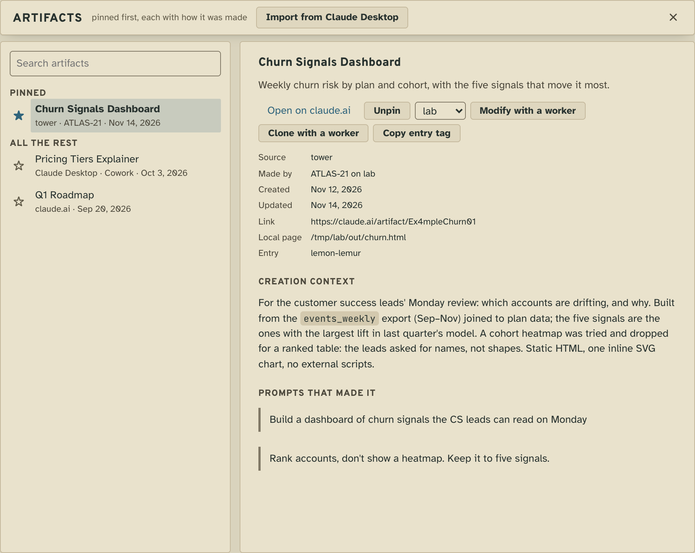
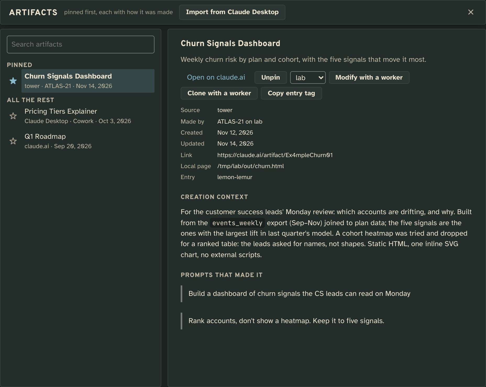

# Artifacts

A catalog of your claude.ai artifacts in the tower: the ones your workers publish, recorded as they do it, and the
ones you import from Claude Desktop and the claude.ai gallery. Each one keeps the context it was made in, so any
worker can modify or clone it without starting over. The ones you pin stay on top.

## What it adds

- **The main pane:** the Artifacts gallery (the page icon beside Floors and Stats, or the palette). Pinned artifacts
  come first, then the rest, newest first, searched by title, description, summary and who made it. Click one to
  see its link, the worker, floor or Desktop chat that made it, its creation context and the prompts behind it. From
  there you can open it on claude.ai, pin or unpin it, or hire a worker on a floor you pick to **modify** it (same
  link) or **clone** it (a new artifact). The worker starts from the entry.

  | Light | Dark |
  | --- | --- |
  |  |  |

- **The workers:** a Claude hook on the Artifact tool. Each time a worker publishes a page, the hook records it in
  the catalog with its link, title, local file, the worker, the floor and the chat's prompts, then asks the worker to
  write the creation context while it still holds it. Two skills ship with it: `artifacts:import` and
  `artifacts:work`. What `tower whoami` shows:

  ```
  artifacts  ·  claude.ai artifacts catalog: each one you publish is recorded; write its context when asked (`tower x artifacts context`). `tower kept artifacts` lists them, `tower read <tag>` one.
  ```

- **The CLI:** `tower x artifacts desktop | add | context | pin | unpin`, and `tower kept artifacts` / `tower read
  <tag>` for the entries, which live in a tower-wide collection.

Tower 3D and The Week draw nothing of it.

## Add it

```json
{ "extensions": { "artifacts": { "path": "/path/to/tower/examples/extensions/artifacts" } } }
```

The hook and skills reach sessions that start after the extension is added; a running worker doesn't get them.

## What it needs from you

- `desktop`: Claude Desktop's data folder, `~/Library/Application Support/Claude` by default. **Import from Claude
  Desktop** (or `tower x artifacts desktop`) reads the Cowork `artifacts.json` files there, plus the local chat each
  artifact came from: its title, its transcript and its prompts.
- The claude.ai gallery is reachable only through Claude's Artifact tool, so a worker imports it. Ask one to
  "import my artifacts" and the `artifacts:import` skill lists the gallery, adds every artifact, then writes the
  summaries.

## How it works

- **Entries** are markdown files in the tower-wide `artifacts` collection, named by the artifact's id, so one artifact
  is one entry whoever records it. Each has a `# Title`, a JSON header (`url`, `source`, dates, `pinned`, `callsign`,
  `project`, `file`, `chat`, `transcript`), then `## Summary` (written by a worker) and `## Prompts` (taken from the
  chat). Re-recording or re-importing an entry refreshes it and keeps its pin and its summary. A later change by
  another worker keeps the original chat's prompts.
- **Server** (`server.ts`): the verbs that write entries. It reads only local files, never the network.
- **Plugin**: `hooks/record.mjs` passes each Artifact publish (never a read, a list or an asset upload) to
  `tower x artifacts record` and hands its answer back to the worker as context.
- **Client**: `gallery.ts` (the view), `commands.ts` (opens it) and `artifact.ts`, the entry format, which the server
  shares.

**Where the context comes from:** a worker's chat and a local Cowork chat are on this machine, so their prompts are
read directly and the worker writes the summary. A Cowork artifact made in a cloud session, and an artifact from a
claude.ai chat, have no transcript here: their summary is written from the page itself.

## Pictures

`npm run tool:extension-shots -- examples/extensions/artifacts`, from the made-up entries in `shots/seed/`.
